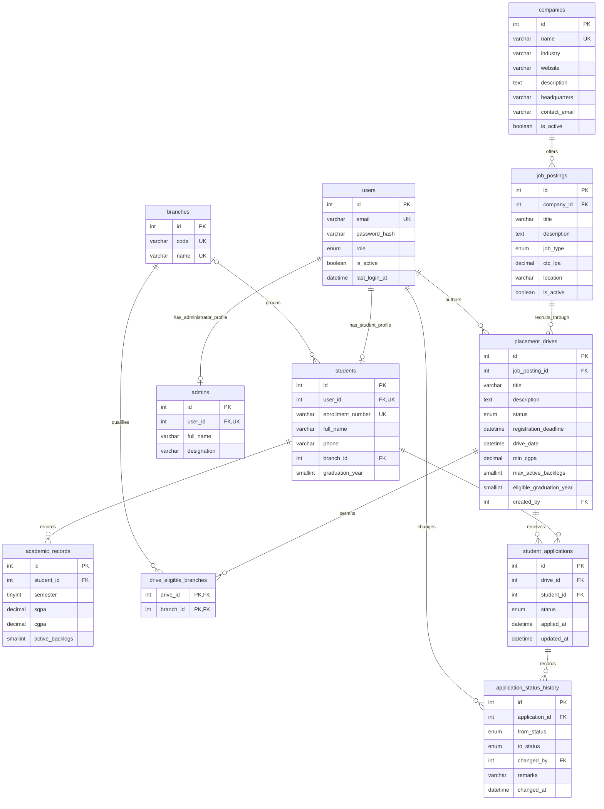

# MySQL ER diagram — Phase 2

This diagram describes the implemented InnoDB schema, not future API endpoints. `database/mysql/schema.sql` contains every column, default and constraint; the 17 migrations are authoritative. All surrogate ids are `INT UNSIGNED`; the eligibility bridge uses its two foreign keys as its composite primary key.

Tables with editable records also have `created_at` and `updated_at` UTC DATETIME columns (users, students, admins, academic_records, companies, job_postings, placement_drives). Reference branches and the eligibility bridge have no timestamp requirement. Bookkeeping `schema_migrations` is not a domain entity.

## Integrity and normalization

- Unique keys: users.email; branches.code/name; students.user_id/enrollment_number; admins.user_id; academic_records(student_id, semester); applications(drive_id, student_id). The eligibility bridge's PK prevents duplicate branch eligibility.
- FK deletes default to RESTRICT. Only academic_records.student_id and drive_eligible_branches.drive_id use CASCADE, because those rows have no independent lifecycle. Applications/history additionally have BEFORE DELETE rejection triggers (BR-12), including an application with no history yet.
- CHECK constraints enforce CGPA/SGPA 0–10, semester 1–12, nonnegative CTC, boolean 0/1, nonempty required text, graduation years 2000–2200, and nonidentical historical from/to states. Unsigned numeric types reject negative counts in strict SQL mode. ENUMs constrain vocabularies, not state transitions.
- Students may start with NULL enrollment/name/branch/year so future registration can precede profile completion. Multiple NULL enrollment numbers are permitted; non-NULL enrollments are unique. Publish-time eligibility fields may be NULL on drafts; future service validation will enforce BR-18. Full administrator names, drive deadlines and foreign-key parent ids are required.
- 1NF: no branch lists or recruitment-round arrays in SQL. 2NF: bridge attributes depend on the whole composite key. 3NF: company data appears only in companies, drive company is derived via its posting, branch names appear only in branches, and student CGPA is derived from the highest-semester academic record. Eligibility scalars belong directly to the drive; a redundant one-to-one eligibility table would add no independent entity.
- Roles are defined on users. FK constraints enforce identity existence; consistency between a user's role and its profile/author actions will be enforced in future services. No authentication or role enforcement is claimed here.

## Views

| View                          | Purpose                                                                                                         |
| ----------------------------- | --------------------------------------------------------------------------------------------------------------- |
| `v_drive_overview`            | Drive → posting → company join, without duplicated company ids on drives                                        |
| `v_student_academic_summary`  | Student plus highest-semester academic row; incomplete profiles remain visible with NULL academics              |
| `v_application_details`       | Application, student, drive, posting, company projection; future access must be owner/admin restricted          |
| `v_placement_stats_by_branch` | All branches, distinct student totals and distinct selected students; a student with several offers counts once |

Views use SQL SECURITY INVOKER. They do not expose password hashes. No session-store table is created before the session implementation selects its schema in Phase 3.
